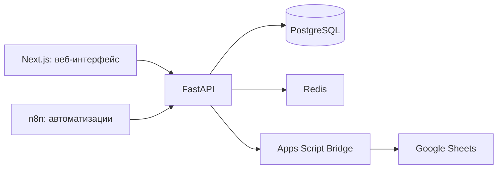
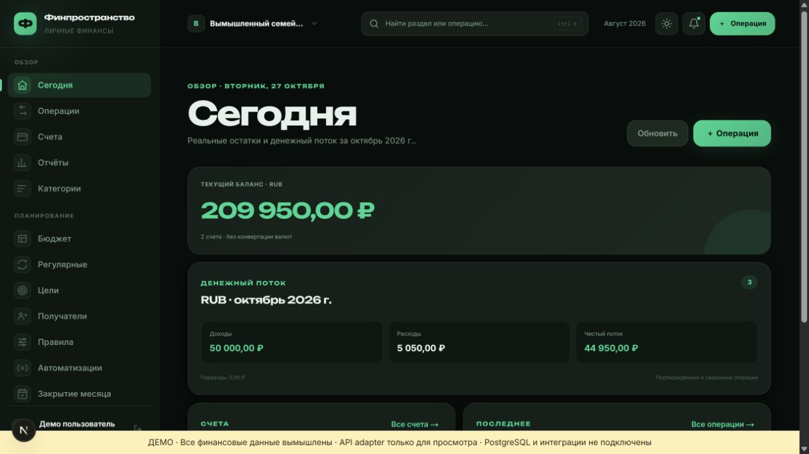

# Финпространство

Веб-приложение для личных и семейных финансов. Позволяет вести операции по счетам, планировать бюджет, отслеживать цели и сверять остатки.

## Возможности

- Пространства с пользователями и ролями, счета, категории и контрагенты.
- Доходы, расходы, переводы, импорт и правила категоризации.
- Бюджеты, прогнозы и повторяющиеся операции.
- Финансовые цели, отчёты и закрытие месяца.
- Синхронизация с Google Sheets через Apps Script Bridge.
- Дополнительные автоматизации через n8n.

## Архитектура



**Стек:** Python, FastAPI, SQLAlchemy, Alembic, PostgreSQL, Redis, TypeScript, Next.js/React и Docker Compose.

## Локальное знакомство

Требуются Docker и Docker Compose. Используйте вымышленные финансовые данные.

```sh
cp .env.example .env
# Задайте собственные значения пароля БД и секретов в .env.
docker compose up -d --build
docker compose exec backend alembic upgrade head
docker compose exec backend python -m app.db.seed
```

Откройте `http://localhost:3000/register`, создайте пользователя и пространство. Конфигурация по умолчанию предназначена для разработки. Для первого знакомства Google Sheets и n8n не требуются; их настройка выполняется отдельно.

## Где смотреть код

- `backend/app/api/routes` — HTTP API.
- `backend/app/services` — прикладная логика финансовых операций.
- `frontend/src` — интерфейс приложения.
- `google-apps-script` — обмен с таблицей.
- `scripts` — проверки, обслуживание и резервное копирование.

## Ограничения

Прямые подключения к банкам, MFA и отдельное мобильное приложение не входят в поддерживаемую область. Синхронизация и резервное восстановление требуют отдельной настройки и проверки. Наличие проверок в коде не подтверждает готовность текущей версии к выпуску или состояние конкретного сервера.

Не публикуйте заполненный `.env`, рабочие документы и резервные копии. Лицензия, разрешающая свободное распространение проекта, пока не задана.

## Поддержка и приёмка

[Границы поддерживаемой версии](docs/supported-scope.md), [порядок выпуска](docs/release.md), [проверки PostgreSQL](docs/validation.md). Конкретные серверные адреса, SSH и Google identifiers хранятся вне публичного Git.

## Посмотреть без рабочих аккаунтов

[Read-only demo](docs/demo.md) использует настоящий Next.js UI с отдельным adapter и вымышленными данными. Полные операции и интеграции требуют основного backend.

## Проверка и реальный экран

[Результаты и ограничения проверки](docs/verification.md). Скриншот получен при локальном запуске на вымышленных данных.


